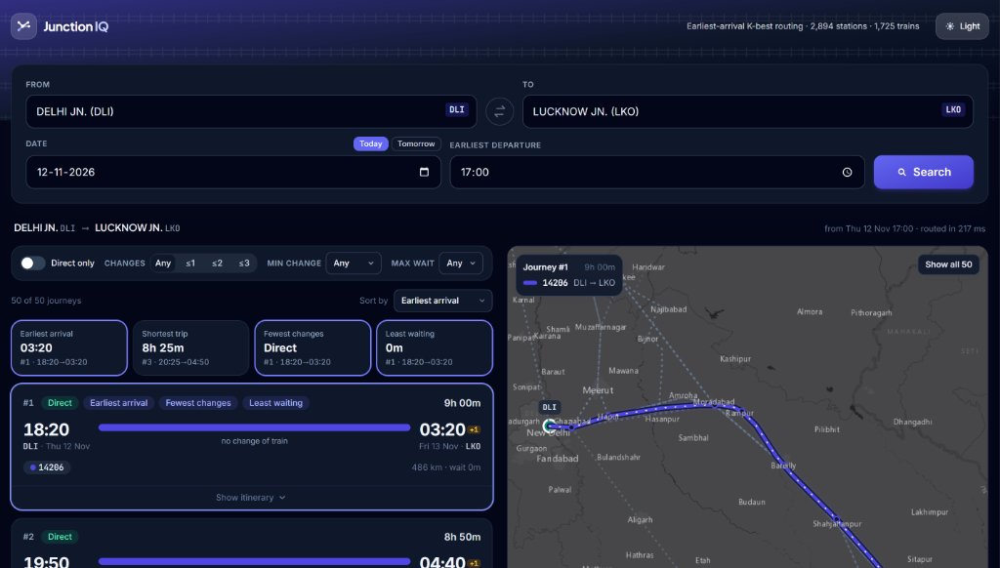
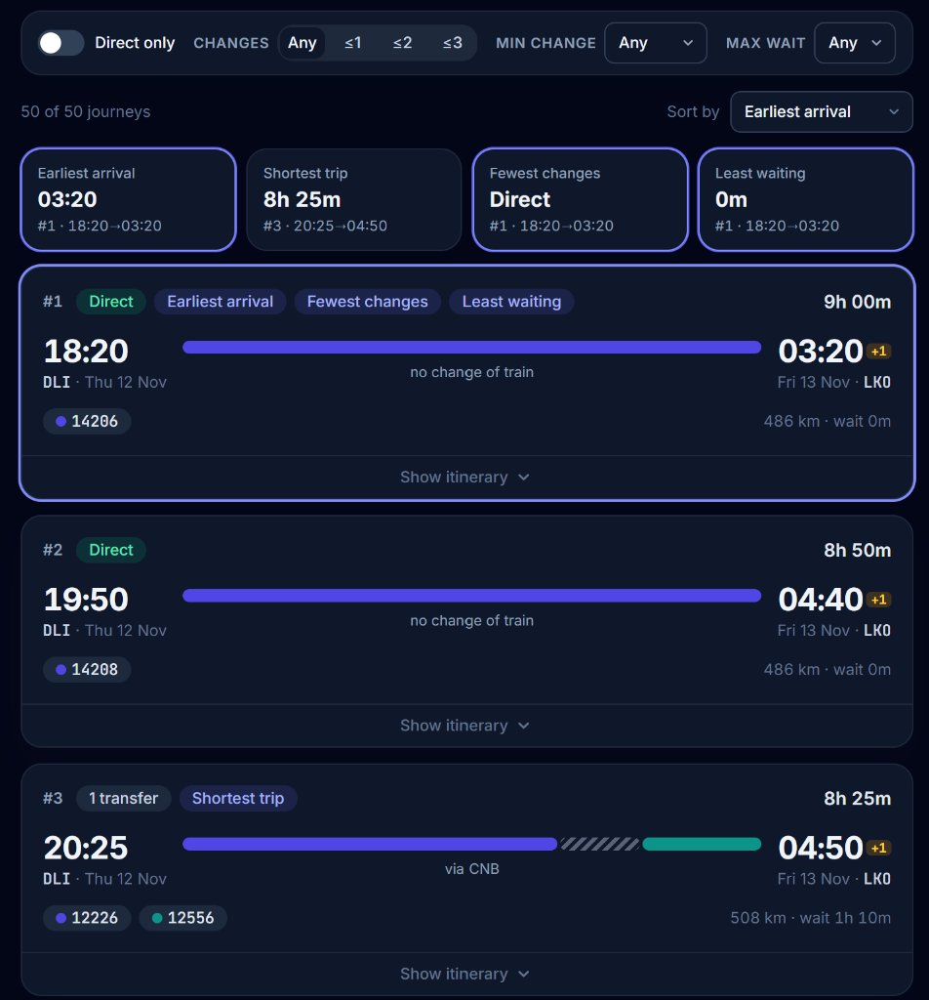

<div align="center">

# Junction IQ

**Earliest-arrival journey planning for Indian Railways: multi-transfer, ranked, and visualized on a map.**

[](https://github.com/Nikky-SDE/JunctionIQ/actions/workflows/ci.yml)
[](https://nodejs.org)
[](https://react.dev)
[](https://www.typescriptlang.org)
[](routing-engine)
[](https://junctioniq-app.netlify.app/)
[](LICENSE)

[**Live Demo**](https://junctioniq-app.netlify.app/) · [Report a Bug](https://github.com/Nikky-SDE/JunctionIQ/issues) · [Request a Feature](https://github.com/Nikky-SDE/JunctionIQ/issues)



</div>

---

## Table of Contents

- [Overview](#overview)
- [Key Features](#key-features)
- [Screenshots](#screenshots)
- [Architecture](#architecture)
- [Routing Algorithm](#routing-algorithm)
- [Tech Stack](#tech-stack)
- [Project Structure](#project-structure)
- [Getting Started](#getting-started)
- [Configuration](#configuration)
- [API Reference](#api-reference)
- [Testing and CI](#testing-and-ci)
- [Deployment](#deployment)
- [Performance](#performance)
- [Known Limitations and Roadmap](#known-limitations-and-roadmap)
- [Contributing](#contributing)
- [Data Sources](#data-sources)
- [Third-Party Notices](#third-party-notices)
- [License](#license)
- [Author](#author)

---

## Overview

Junction IQ computes the **50 earliest-arriving valid journeys** between any two of **2,894 stations** using **1,725 train schedules**. Direct trains and multi-transfer itineraries are ranked together in one result set, so you see the fastest way to arrive regardless of how many changes it takes.

| Metric | Value |
|---|---|
| Stations | 2,894 |
| Train schedules | 1,725 (0 rejected during preprocessing) |
| Boardable stops | 30,796 |
| Journeys returned per query | Up to 50 |
| Minimum transfer buffer | 30 minutes |
| Stations geocoded for the map | 2,859 (98.8%) |

## Key Features

- **Earliest-arrival K-best routing**: direct and multi-transfer journeys ranked together using a backward lower-bound scan and a best-first A\* search.
- **Dual routing engines**: an in-process Node.js engine (`JsRoutingEngine`) that also powers Netlify Functions, plus an optional C++20 engine (`HttpRoutingEngine`) for Docker/Linux, with automatic fallback to the JS engine.
- **Interactive route map**: journey legs, intermediate stops, and transfer junctions drawn with Leaflet on Esri Light/Dark Gray Canvas tiles, synchronized with the active theme.
- **Filtering and sorting**:
  - Filter by direct-only, maximum changes, minimum change time, and maximum wait.
  - Sort by arrival, duration, transfers, waiting time, or distance.
  - Highlight cards for earliest arrival, shortest trip, fewest changes, and least waiting.
- **Quick access**: one-click popular corridors (`NDLS → MMCT`, `CSMT → PUNE`, `HWH → MAS`, `SBC → NDLS`) and persistent recent searches.
- **Shareable searches**: search state is synced to the URL.
- **Dark and light themes**: a tokenized CSS design system with a persisted theme toggle.

## Screenshots

| Search, filters, and route map | Ranked journey results |
|:---:|:---:|
|  |  |

## Architecture

```text
┌──────────────────────┐     /api/*     ┌────────────────────────────┐
│  React + Vite SPA    │ ─────────────▶ │  Express API / Netlify Fn  │
│  Leaflet map, UI     │                │  Zod request validation    │
└──────────────────────┘                └──────────────┬─────────────┘
                                                       │
                                          RouteService (engine → renderer
                                          → filters → pagination)
                                                       │
                                  ┌────────────────────┴───────────────────┐
                                  ▼                                        ▼
                       ┌─────────────────────┐              ┌──────────────────────┐
                       │   JsRoutingEngine   │   fallback   │  HttpRoutingEngine   │
                       │   (in-process)      │ ◀─────────── │  → C++20 engine      │
                       └─────────────────────┘   (auto)     └──────────────────────┘
                                  ▲                                        ▲
                                  └─────────── timetable.json ─────────────┘
                                                stations.json
```

### Engine Modes

`ENGINE_MODE` (default `auto`) selects the routing backend for the Express API:

| Mode | Behavior |
|---|---|
| `js` | Always uses the in-process Node.js engine. |
| `http` | Always calls the C++ engine at `ENGINE_URL`. No fallback: the API returns 503 if the engine is down. |
| `auto` | Tries the C++ engine first (5 s timeout). On connection errors, timeouts, or 502/503 it silently falls back to the JS engine. Validation errors (HTTP 400) are returned as-is without fallback. |

> **Netlify** deployments use `JsRoutingEngine` directly. They do not use `ENGINE_MODE` or the C++ engine.

## Routing Algorithm

Both engines consume the same `railway-timetable/v1` schema (`timetable.json`) and optimize in this order: **earliest arrival, then latest departure, fewest transfers, least waiting**. Distance is computed for display only and never affects ranking.

1. **Validation**: `POST /api/routes` normalizes station codes, validates the date and time, rejects identical source and destination, and checks both stations exist.
2. **Timetable indexing**: trains are indexed by station and time of day. The C++ engine precomputes one connection pattern per weekday; the JS engine enumerates active train instances per query.
3. **Backward profile scan**: connections inside the search horizon (default 5,760 min = 4 days) are scanned in descending departure order to compute a lower bound on arrival time from every stop, queried at `arrival + minimum transfer time` (30 min).
4. **Best-first A\* search**: labels are expanded from a priority queue ordered by lower-bound arrival, with expansions for boarding, riding on, and alighting. The search stops when K = 50 journeys are accepted or the label budget is exhausted.
5. **Pruning**: stations are never repeated within a journey, and stay-on ceiling pruning drops labels that cannot beat a direct continuation. The C++ engine adds dominance checks for boarding too late or leaving a train too early.
6. **Rendering and filtering**: compact `[train, board, alight, startDay]` legs are hydrated into full itineraries (distance, durations, waits, intermediate stops), then filtered and paginated.

### C++ vs JS Engine

The engines share the algorithm but not every limit. Queries that fall back from C++ to JS use the JS limits.

| Capability | C++20 engine | JS engine |
|---|---|---|
| Max transfers | 10 (`MAX_TRANSFERS_INTERNAL`) | 6 (hardcoded) |
| Label budget | 500,000 (`MAX_LABELS`) | 150,000 (hardcoded) |
| First-leg departure cap | Query calendar day | Entire search horizon |
| Departure lookup | Binary search by time of day | Linear scan on transfers |
| Dominance pruning (`boards_train_late`, `leaves_train_early`) | Yes (toggle with `PRUNE_*`) | No |
| Runtime | Linux / Docker | Any Node.js 22 environment, Netlify Functions |

## Tech Stack

| Layer | Technologies |
|---|---|
| Frontend | React 19, TypeScript 5.9, Vite 6, Tailwind CSS v4, Leaflet / React-Leaflet |
| API | Node.js 22, Express 5, Zod 4 |
| Serverless | Netlify Functions (`netlify/functions/api.mjs`) |
| Routing engines | JavaScript K-best A\* engine; C++20 engine (CMake, `cpp-httplib`, `nlohmann/json`) |
| Data pipeline | TypeScript preprocessing and geocoding (`scripts/`) |
| Tooling | GitHub Actions CI, Docker Compose, Node's built-in test runner |
| Typography | Plus Jakarta Sans, Inter, JetBrains Mono |

## Project Structure

```text
JunctionIQ/
├── .github/workflows/ci.yml   # CI: API tests, script tests, frontend typecheck + build
├── api/                       # Express REST API + JS routing engine
│   ├── src/
│   │   ├── app.js             # Express app, security headers, error handling
│   │   ├── config.js          # Environment configuration
│   │   ├── server.js          # Entry point and engine wiring
│   │   └── services/          # apiHandlers, engineClient, jsEngine, routeService,
│   │                          # journeyRenderer, filters, stationService
│   └── test/api.test.js       # Integration tests
├── frontend/                  # React 19 + TypeScript + Vite + Tailwind v4 SPA
│   ├── server.js              # Production static server and /api/* proxy
│   └── src/                   # App.tsx, components/, lib/
├── routing-engine/            # C++20 routing engine (Linux / Docker)
│   ├── src/                   # router, timetable, server, JSON serializer
│   └── third_party/           # Vendored MIT headers
├── scripts/                   # Preprocessing, geocoding, dev launcher, tests
├── data/
│   ├── external/              # DataMeet station coordinates (CC0)
│   ├── processed/             # stations.json, timetable.json, trains.json
│   └── reports/               # Data quality and geocoding reports
├── netlify/functions/api.mjs  # Serverless adapter
├── train_data/                # 1,725 raw train JSON records
├── docker-compose.yml         # engine + api + frontend
└── netlify.toml               # Build, security headers, redirects
```

## Getting Started

### Prerequisites

- **Node.js ≥ 22.16** and npm
- *(Optional)* Docker and Docker Compose, or CMake ≥ 3.20 with a Linux C++20 toolchain, to run the C++ engine

### Installation

```bash
git clone https://github.com/Nikky-SDE/JunctionIQ.git
cd JunctionIQ
cp .env.example .env

cd api && npm ci
cd ../frontend && npm ci
cd ..
```

### Run Locally

```bash
npm run dev
```

| Service | URL |
|---|---|
| Frontend (Vite) | http://localhost:3000 |
| API (Express) | http://localhost:4000 |

Locally the API runs with `ENGINE_MODE=auto`. With no C++ engine running it uses `JsRoutingEngine`.

### Run with Docker (full stack with C++ engine)

```bash
docker compose up -d --build
```

This starts three services: the C++ engine, the API, and the frontend (served on `PUBLIC_PORT`, default `80`).

### Run the C++ Engine Natively (Linux / macOS)

```bash
cmake -S routing-engine -B routing-engine/build -DCMAKE_BUILD_TYPE=Release
cmake --build routing-engine/build -j
TIMETABLE_PATH=data/processed/timetable.json ./routing-engine/build/routing_engine
```

> Native Windows builds are not supported because the engine uses POSIX APIs. On Windows, use Docker or WSL.

### Regenerate Data

```bash
cd scripts
npm run preprocess   # train_data/ → data/processed/ and quality reports
npm run geocode      # station geocoding and route interpolation
```

## Configuration

Copy `.env.example` to `.env`. Every variable is optional.

<details>
<summary><strong>API and serverless</strong></summary>

| Variable | Description | Default |
|---|---|---|
| `API_PORT` | Express listen port | `4000` |
| `API_HOST` | Express bind address | `0.0.0.0` |
| `ENGINE_MODE` | `auto`, `http`, or `js` (invalid values fall back to `auto`) | `auto` |
| `ENGINE_URL` | C++ engine base URL | `http://127.0.0.1:7070` |
| `STATIONS_FILE` | Path to `stations.json` | `<repo>/data/processed/stations.json` |
| `TIMETABLE_PATH` | Path to `timetable.json` | `<repo>/data/processed/timetable.json` |
| `CORS_ORIGIN` | Value for `Access-Control-Allow-Origin` | disabled |
| `MAX_RESULTS` | Maximum journeys returned per search | `50` |

</details>

<details>
<summary><strong>Frontend and Docker</strong></summary>

| Variable | Description | Default |
|---|---|---|
| `PORT` | Production static server port | `3000` |
| `HOST` | Production static server bind address | `0.0.0.0` |
| `API_INTERNAL_URL` | Upstream for the `/api/*` proxy | `http://127.0.0.1:4000` (`http://api:4000` in Compose) |
| `PUBLIC_PORT` | Host port mapped to the frontend container | `80` |

</details>

<details>
<summary><strong>C++ routing engine</strong></summary>

These variables configure the C++ engine only. `JsRoutingEngine` uses fixed values (`minTransferMinutes=30`, `maxTransfers=6`, `horizonMinutes=5760`, `maxLabels=150000`).

| Variable | Description | Default |
|---|---|---|
| `ENGINE_HOST` | Bind address | `0.0.0.0` |
| `ENGINE_PORT` | Query port | `7070` |
| `ENGINE_THREADS` | Worker thread count | `8` |
| `ADMIN_PORT` | Health-check port (`0` disables) | `7071` |
| `SHUTDOWN_GRACE_MS` | Drain time on SIGTERM / SIGINT | `3000` |
| `WORKER_ID` | Identifier reported in `/health` and `/route` | `engine` |
| `MIN_TRANSFER_MINUTES` | Minimum time between arriving and departing trains | `30` |
| `MAX_TRANSFERS_INTERNAL` | Maximum transfers per journey | `10` |
| `TOP_K` | Journeys computed per query | `50` |
| `K_NODE` | Per-stop board/alight expansion cap (`0` disables) | `0` |
| `PRUNE_STAY_ON` | Stay-on ceiling and `leaves_train_early` pruning (`0` disables) | `1` |
| `PRUNE_BOARD_EARLIER` | `boards_train_late` pruning (`0` disables) | `1` |
| `SEARCH_HORIZON_MINUTES` | Forward search window (clamped 60–43,200) | `5760` |
| `MAX_LABELS` | Label cap before the search is truncated | `500000` |

</details>

<details>
<summary><strong>Data pipeline</strong></summary>

| Variable | Description | Default |
|---|---|---|
| `RAW_DATA_DIR` | Raw train JSON input | `<repo>/train_data` |
| `PROCESSED_DIR` | Processed JSON output | `<repo>/data/processed` |
| `REPORTS_DIR` | Quality and geocode reports | `<repo>/data/reports` |
| `CLEAN_POLICY` | Schedule repair policy: `strict`, `correct`, or `skip` | `correct` |

</details>

## API Reference

| Method | Endpoint | Description |
|---|---|---|
| `GET` | `/api/stations?q=<query>` | Station autocomplete. Results are ranked by exact code, code prefix, name/alias prefix, then substring, then train count. |
| `GET` | `/api/stations/:code` | Look up a station by code. |
| `POST` | `/api/routes` | Compute ranked journeys between two stations. |
| `GET` | `/api/health` | Health and engine status. |

Example request:

```bash
curl -X POST http://localhost:4000/api/routes \
  -H "Content-Type: application/json" \
  -d '{"source":"NDLS","destination":"MMCT","date":"2026-11-12","time":"17:00"}'
```

Source and destination codes are uppercased, `date` uses `YYYY-MM-DD`, and `time` uses `HH:MM`. Optional filters include `max_duration_minutes`, `max_transfers`, and `direct_only`. Errors use the shape `{ "error": { "code": "...", "message": "..." } }`.

## Testing and CI

```bash
npm test                                           # Complete test suite: API + scripts + frontend + ESLint

cd api && npm test                                 # API integration & routing algorithm tests
cd scripts && npm test                             # Normalization and geocoding tests
cd frontend && npm test && npm run lint            # Frontend unit tests and ESLint
cd frontend && npm run typecheck && npm run build  # Typecheck and production build
```

GitHub Actions ([`ci.yml`](.github/workflows/ci.yml)) runs the complete test matrix (API integration tests, preprocessing pipeline tests, frontend unit tests, ESLint, TypeScript check, and Vite production build) on every push and pull request.

## Deployment

### Netlify

[`netlify.toml`](netlify.toml) and [`netlify/functions/api.mjs`](netlify/functions/api.mjs) configure the full-stack deployment, including security headers and API/SPA redirects. Netlify runs `JsRoutingEngine` only.

| Setting | Value |
|---|---|
| Build command | `cd api && npm ci && cd ../frontend && npm ci && npm run build` |
| Publish directory | `frontend/dist` |
| Functions directory | `netlify/functions` |
| Node.js version | `22` |

### Docker

`docker compose up -d --build` runs the C++ engine, API, and frontend as three containers. The API reaches the engine at `http://engine:7070` and falls back to the JS engine if it is unavailable (`ENGINE_MODE=auto`).

To serve the production frontend without Docker: `cd frontend && npm start`.

## Performance

There is no formal benchmark suite yet. The numbers below are one-off measurements of the **JS engine** on a local development machine, not guarantees.

| Measurement | Result |
|---|---|
| Timetable load (`timetable.json`) | ~19–26 ms |
| Single `NDLS → MMCT` query (limit 10) | ~40–46 ms |
| `GET /api/stations?q=NDLS`, 20 concurrent users, 8 s | avg 21.7 ms, p95 26.8 ms, ~921 req/s, 0% errors |
| `POST /api/routes`, 20 concurrent users, 8 s | avg 545 ms, p95 746 ms, ~38 req/s, 0% errors |

C++ engine latency, throughput, and memory use have not been measured.

## Known Limitations and Roadmap

### Known limitations

- **Engine parity**: the JS engine defaults to 6 transfers and a 150,000 label budget, whereas C++ supports up to 10 transfers and 500,000 labels (see [C++ vs JS Engine](#c-vs-js-engine)).
- **35 stations (1.2%)** have no coordinates, so map routes draw straight lines past them.
- **C++ test and bench directories** referenced in `CMakeLists.txt` are designed for Linux/Docker environments.

### Roadmap

- [x] Add a circuit breaker and cooldown to the hybrid engine, and share one parsed timetable between the renderer and JS engine.
- [x] Implement in-memory sliding-window rate limiting on `POST /api/routes` for Express and Netlify Functions.
- [x] Add ESLint and automated frontend unit tests covering filters, sorting, URL state sync, highlights, and geometry.
- [ ] Read `MAX_TRANSFERS_INTERNAL`, `MIN_TRANSFER_MINUTES`, `SEARCH_HORIZON_MINUTES`, and `MAX_LABELS` in the JS engine for configurable parity with C++.
- [ ] Add the C++ test suite and a benchmark harness, and publish C++ vs JS comparisons.
- [ ] Resolve coordinates for the remaining 35 stations.

## Contributing

Contributions are welcome.

1. Fork the repository and create a feature branch from `main`.
2. Set up the project as described in [Getting Started](#getting-started).
3. Make your changes and make sure these pass, as in CI:
   ```bash
   cd api && npm test
   cd ../scripts && npm test
   cd ../frontend && npm run typecheck && npm run build
   ```
4. Open a pull request against `main` describing what changed and why.

For bugs or feature ideas, please [open an issue](https://github.com/Nikky-SDE/JunctionIQ/issues) first.

## Data Sources

- **Station coordinates**: [DataMeet Railways](https://github.com/datameet/railways) (CC0).
- **Train schedules**: 1,725 raw train records in `train_data/`, normalized by `scripts/preprocess.ts`. Quality and geocoding reports are in `data/reports/`.
- **Map tiles**: Esri Light/Dark Gray Canvas, © Esri, © OpenStreetMap contributors.

## Third-Party Notices

| Component | License | Author |
|---|---|---|
| `routing-engine/third_party/doctest.h` | MIT | Viktor Kirilov |
| `routing-engine/third_party/httplib.h` | MIT | Yuji Hirose |
| `routing-engine/third_party/json.hpp` | MIT | Niels Lohmann |
| `data/external/datameet-stations.json` | CC0 | DataMeet Railways |

## License

Distributed under the MIT License. See [`LICENSE`](LICENSE) for details.

## Author

**Nikky**
[nikkycsai2006@gmail.com](mailto:nikkycsai2006@gmail.com) · [GitHub](https://github.com/Nikky-SDE)
